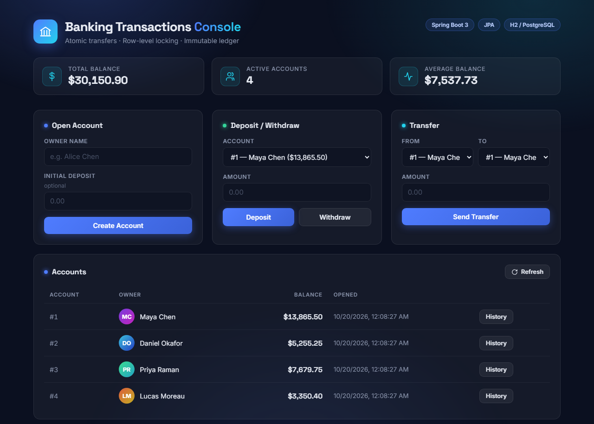

# Banking Transactions API

[](https://github.com/Lego514/banking-transactions-api/actions/workflows/ci.yml)

**RESTful banking transactions service with atomic transfers — Spring Boot 3, JPA, row-level locking tested under concurrency on real PostgreSQL, CI on every push, and a zero-dependency web console.**

A small but production-shaped core banking service: open accounts, move money, and audit every cent through an immutable transaction ledger. Built to demonstrate the engineering concerns banks actually care about — atomicity, concurrency safety, and auditability — not framework tourism.



## Features

- **Accounts** — open an account (optional initial deposit), list accounts, check balances
- **Deposits / withdrawals** — with overdraft rejection
- **Atomic transfers** — both legs succeed or neither does; money is never created or destroyed
- **Immutable ledger** — every movement writes an audit row with the post-transaction balance
- **Web console** — a vanilla-JS dashboard served by the same app (no build step) at `http://localhost:8080`

## API

| Method | Path | Description | Errors |
|---|---|---|---|
| `POST` | `/api/accounts` | Open account `{ownerName, initialDeposit?}` | 400 validation |
| `GET` | `/api/accounts` | List all accounts | |
| `GET` | `/api/accounts/{id}` | Account details + balance | 404 |
| `POST` | `/api/accounts/{id}/deposit` | `{amount}` | 400, 404 |
| `POST` | `/api/accounts/{id}/withdraw` | `{amount}` | 400, 404, **409 insufficient funds** |
| `GET` | `/api/accounts/{id}/transactions` | Ledger, newest first | 404 |
| `POST` | `/api/transfers` | `{fromAccountId, toAccountId, amount}` | 400, 404, 409 |

All errors return a consistent JSON body:

```json
{ "status": 409, "code": "INSUFFICIENT_FUNDS", "message": "Account 1 has insufficient funds: balance 5.00, requested 10.00", "timestamp": "..." }
```

## Engineering decisions worth asking me about

- **`BigDecimal` for money, never `double`.** Binary floating point cannot represent 0.10 exactly; ledgers drift. Amounts are validated to ≤ 2 decimal places at the service boundary.
- **Pessimistic row locks for concurrent updates.** Balance updates use `SELECT … FOR UPDATE` (`@Lock(PESSIMISTIC_WRITE)`) so two simultaneous withdrawals can't both read the same balance and double-spend.
- **Deadlock-free transfers.** A transfer locks both accounts **in ascending id order**. Two opposite transfers (A→B and B→A) therefore acquire locks in the same order and can never deadlock each other. `TransferConcurrencyTest` checks this on a real PostgreSQL in CI: 100 opposite transfers released at once, with no deadlock, no money created or destroyed, and no balance below zero.
- **Transfers are one database transaction.** The debit, credit, and both ledger rows commit together; if the debit fails everything rolls back (`@Transactional`).
- **Ledger rows are immutable and store `balanceAfter`.** You can audit any account's history without replaying it, and no code path ever updates or deletes a ledger row.

## Running locally

Requires JDK 21+. No database install needed — defaults to in-memory H2.

```bash
mvn spring-boot:run
# UI:  http://localhost:8080
# API: http://localhost:8080/api/accounts
```

To run against PostgreSQL instead:

```bash
createdb banking
mvn spring-boot:run -Dspring-boot.run.profiles=postgres   # DB_USER / DB_PASSWORD env vars
```

## Operational endpoints (Spring Boot Actuator)

Production services need to prove they're healthy before a load balancer sends them traffic. Actuator exposes:

| Endpoint | Purpose |
|---|---|
| `/actuator/health` | Overall status, including a real database connectivity check (`db: UP`), not just "the process exists" |
| `/actuator/metrics` | JVM memory, HTTP request latencies (`http.server.requests`), connection-pool stats |
| `/actuator/info` | App name/version for deployment verification |

As configured here, all three are public and `health` shows full details (database type, disk space), which suits a local demo. A real deployment would expose only `health` (`management.endpoints.web.exposure.include=health`), hide its details from anonymous callers (`management.endpoint.health.show-details=when-authorized`), and serve metrics to Prometheus on an internal management port (`management.server.port`). On Kubernetes, Spring Boot also adds `/actuator/health/liveness` and `/actuator/health/readiness` for the probes.

## Tests & CI

```bash
mvn test                          # 19 tests on H2; the PostgreSQL tests are skipped
POSTGRES_TESTS=true mvn test      # all 21 (needs Docker)
```

Every push and pull request triggers a GitHub Actions pipeline (`.github/workflows/ci.yml`) that builds the project and runs all 21 tests on JDK 21, including the PostgreSQL ones (Testcontainers starts PostgreSQL 16 in Docker); failed runs upload the surefire reports as an artifact for debugging.

21 tests across three layers:

- **Service layer** (`AccountServiceTest`, 13 tests) — balance math, overdraft rejection, amount validation, transfer atomicity (failed transfers leave both balances and the ledger untouched), same-account rejection, ledger ordering
- **Web layer** (`AccountControllerTest`, 6 tests) — full HTTP round-trips through MockMvc asserting status codes and JSON error contracts (201/400/404/409)
- **Concurrency on real PostgreSQL** (`TransferConcurrencyTest`, 2 tests) — a smoke test that the datasource really is PostgreSQL, and a race: 50 A→B and 50 B→A transfers released together on 8 threads. It asserts that nothing failed except for insufficient funds (a deadlock would fail it), the total is unchanged, no balance went below zero, and the ledger has one entry per side of every transfer that went through. H2 can't stand in here, because the claim under test is how PostgreSQL's `SELECT … FOR UPDATE` behaves.

## Repository structure

```
src/main/java/com/ray/banking/
├── model/        Account, TransactionRecord (JPA entities), TransactionType
├── repository/   Spring Data repositories (incl. SELECT FOR UPDATE lock)
├── service/      AccountService — all business rules and transaction boundaries
├── web/          REST controllers, DTOs, global exception handler
src/main/resources/static/   web console (vanilla HTML/CSS/JS)
src/test/java/               service, controller, and PostgreSQL concurrency tests
```

## What I'd do next with more time

- JWT authentication and per-user account ownership
- Idempotency keys on transfers so client retries can't double-move money
- Docker Compose (app + Postgres)
- Pagination on the transactions endpoint

## About me

Ray — MSCS, University of Delaware (May 2026), based in Wilmington DE. Open to Software Engineer and Data Analyst roles. This project is the SWE companion to my data analytics portfolio (hospital readmission risk, credit card default risk).
