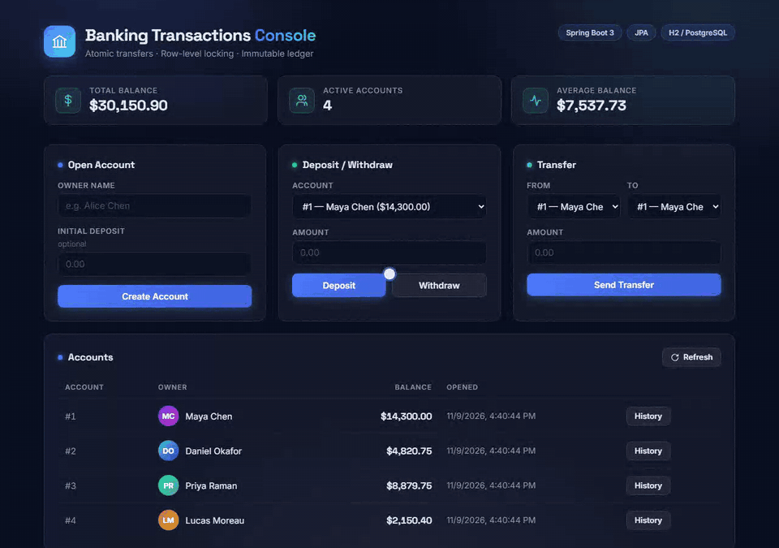

# Banking Transactions API

[](https://github.com/Lego514/banking-transactions-api/actions/workflows/ci.yml)

**RESTful banking transactions service with atomic transfers — Spring Boot 3, JPA, row-level locking tested under concurrency on real PostgreSQL, CI on every push, and a zero-dependency web console.**

A small but production-shaped core banking service: open accounts, move money, and audit every cent through an immutable transaction ledger. Built to demonstrate the engineering concerns banks actually care about — atomicity, concurrency safety, and auditability — not framework tourism.



*A transfer and its receipt → the same request retried with its `Idempotency-Key` (the server replays the receipt and moves no money; the balances stay put) → an overdraft rejected with its error code → the payee's ledger. Recorded from the bundled web console.*

## Features

- **Accounts** — open an account (optional initial deposit), list accounts, check balances
- **Deposits / withdrawals** — with overdraft rejection
- **Atomic transfers** — both legs succeed or neither does; money is never created or destroyed
- **Immutable ledger** — every movement writes an audit row with the post-transaction balance
- **Web console** — a vanilla-JS dashboard served by the same app (no build step) at `http://localhost:8080`; it shows each transfer's receipt and can retry it with the same `Idempotency-Key`

## API

| Method | Path | Description | Errors |
|---|---|---|---|
| `POST` | `/api/accounts` | Open account `{ownerName, initialDeposit?}` | 400 validation |
| `GET` | `/api/accounts` | List all accounts | |
| `GET` | `/api/accounts/{id}` | Account details + balance | 404 |
| `POST` | `/api/accounts/{id}/deposit` | `{amount}` | 400, 404 |
| `POST` | `/api/accounts/{id}/withdraw` | `{amount}` | 400, 404, **409 insufficient funds** |
| `GET` | `/api/accounts/{id}/transactions` | Ledger, newest first | 404 |
| `POST` | `/api/transfers` | `{fromAccountId, toAccountId, amount}`; optional `Idempotency-Key` header. **201** with a receipt and a `Location` | 400, 404, 409, **422 key reused** |
| `GET` | `/api/transfers/{transferId}` | The receipt of a past transfer | 400, 404 |

Every error returns the same JSON body:

```json
{ "status": 409, "code": "INSUFFICIENT_FUNDS", "message": "Account 1 has insufficient funds: balance 5.00, requested 10.00", "timestamp": "..." }
```

| Code | Status | When |
|---|---|---|
| `VALIDATION_ERROR` | 400 | A request field breaks a rule, including an amount above 99,999,999,999,999,999.99 (the largest a `numeric(19,2)` column holds) |
| `INVALID_TRANSACTION` | 400 | Amount not positive, more than 2 decimal places, a transfer to the same account, a balance that would pass the column's maximum, or an `Idempotency-Key` that is blank or over 255 characters |
| `INVALID_PARAMETER` | 400 | A path variable of the wrong type, such as `/api/accounts/abc` |
| `MALFORMED_REQUEST` | 400 | The body is missing or isn't valid JSON |
| `ACCOUNT_NOT_FOUND` | 404 | No such account |
| `TRANSFER_NOT_FOUND` | 404 | No transfer with that id |
| `INSUFFICIENT_FUNDS` | 409 | Withdrawal or transfer larger than the balance |
| `IDEMPOTENCY_KEY_IN_PROGRESS` | 409 | A request with the same key hasn't finished |
| `IDEMPOTENCY_KEY_REUSED` | 422 | The same key with a different body |
| `NOT_FOUND`, `METHOD_NOT_ALLOWED`, `UNSUPPORTED_MEDIA_TYPE`, … | 404, 405, 415, … | Spring MVC's own errors, named after their status |
| `ACCOUNT_BUSY` | 503 | Another transaction held the account's row lock past the 3 s lock timeout (or the database broke a deadlock); sent with `Retry-After: 1` |
| `DATABASE_ERROR`, `INTERNAL_ERROR` | 500 | A failure on our side; logged in full, answered with a generic message that leaks no hosts, SQL or class names |

`GlobalExceptionHandler` extends Spring's `ResponseEntityExceptionHandler`, so the framework's errors go through the same body instead of an empty one.

## Engineering decisions worth asking me about

- **`BigDecimal` for money, never `double`.** Binary floating point cannot represent 0.10 exactly; ledgers drift. Amounts are validated to ≤ 2 decimal places at the service boundary.
- **Pessimistic row locks for concurrent updates.** Balance updates use `SELECT … FOR UPDATE` (`@Lock(PESSIMISTIC_WRITE)`) so two simultaneous withdrawals can't both read the same balance and double-spend.
- **Deadlock-free transfers.** A transfer locks both accounts **in ascending id order**. Two opposite transfers (A→B and B→A) therefore acquire locks in the same order and can never deadlock each other. `TransferConcurrencyTest` checks this on a real PostgreSQL in CI: 100 opposite transfers released at once, with no deadlock, no money created or destroyed, and no balance below zero.
- **Lock waits are bounded.** PostgreSQL's `lock_timeout` defaults to 0, so a transfer behind a stuck transaction would wait forever and pin a connection. Every connection now sets `lock_timeout = 3000` ms (H2: `LOCK_TIMEOUT=3000`), and a transfer that gives up is answered `503 ACCOUNT_BUSY` with `Retry-After`; nothing was written, and a retry with the same `Idempotency-Key` is safe. It is set per connection because Hibernate ignores the JPA lock-timeout hint on PostgreSQL, whose `FOR UPDATE` has no "wait n seconds" form.
- **Transfers are one database transaction.** The debit, credit, and both ledger rows commit together; if the debit fails everything rolls back (`@Transactional`).
- **A transfer receipt tells the payer nothing about the payee.** It is built from the payer's ledger row alone: transfer id, amount, the payer's balance after, and the payee only as the account id the payer already gave. (The response used to return both accounts in full, the payee's name and balance included.) Timestamps are cut to microseconds before they are stored, because that is all PostgreSQL keeps; otherwise the receipt returned on creation and the one read back later would disagree.
- **Idempotent transfers.** A client that times out can't tell whether its transfer happened, so it retries. With an `Idempotency-Key` header, the key's row is inserted first, in the same transaction as the transfer, and its primary key rejects a second use. A retry with the same key and body gets the stored response back (`Idempotent-Replayed: true`) and moves no money; the same key with a different body is rejected with 422; a transfer that fails rolls its key back, so retrying it runs it for real. `TransferConcurrencyTest` sends one request 8 times at once on a real PostgreSQL and checks the money moves once. The web console sends a key with every transfer, so a double-click can't pay twice.
- **Ledger rows are immutable and store `balanceAfter`.** You can audit any account's history without replaying it, and no code path ever updates or deletes a ledger row. Both legs of a transfer share a `transferId`, so they can be paired exactly.

## Ledger reconciliation (SQL)

[`sql/reconciliation.sql`](sql/reconciliation.sql) holds five checks. Each returns the rows that break one rule, so an empty result means the ledger is consistent:

| Check | Rule | SQL used |
|---|---|---|
| `balance_matches_ledger` | Every stored balance equals the sum of its account's ledger | `LEFT JOIN`, `GROUP BY … HAVING` |
| `balance_after_is_running_total` | Every ledger row's `balance_after` equals the running total up to that row | window function `SUM() OVER (PARTITION BY account_id ORDER BY id)` |
| `transfer_legs_pair_up` | Every transfer has exactly one out leg and one in leg, same amount, each naming the other account | `COUNT(*) FILTER (WHERE …)` |
| `no_negative_balances` | No balance, and no point in any ledger history, is below zero | `UNION ALL` |
| `money_is_conserved` | Money in the bank = deposits − withdrawals; transfers only move it | CTE with scalar subqueries |

The running total is ordered by ledger `id`, not timestamp: a ledger row is inserted while its account's row lock is held, so within one account the id order is the order the balance changes were applied.

```bash
psql -d banking -f sql/reconciliation.sql
```

`LedgerReconciliationTest` runs every check on PostgreSQL in CI after a workload that includes concurrent transfers. A check that never fires proves nothing, so the test also breaks the data once per check (an edited balance, an edited ledger row, a deleted transfer leg, an overdraft, money from nowhere), inside a rolled-back transaction, and asserts the check reports exactly that row.

## Running locally

Requires JDK 21+. No database install needed — defaults to in-memory H2.

```bash
mvn spring-boot:run
# UI:  http://localhost:8080
# API: http://localhost:8080/api/accounts
```

To run against PostgreSQL instead:

```bash
createdb banking
mvn spring-boot:run -Dspring-boot.run.profiles=postgres   # DB_USER / DB_PASSWORD env vars
```

## Operational endpoints (Spring Boot Actuator)

Production services need to prove they're healthy before a load balancer sends them traffic. Actuator exposes:

| Endpoint | Purpose |
|---|---|
| `/actuator/health` | Overall status, including a real database connectivity check (`db: UP`), not just "the process exists" |
| `/actuator/metrics` | JVM memory, HTTP request latencies (`http.server.requests`), connection-pool stats |
| `/actuator/info` | App name/version for deployment verification |

As configured here, all three are public and `health` shows full details (database type, disk space), which suits a local demo. A real deployment would expose only `health` (`management.endpoints.web.exposure.include=health`), hide its details from anonymous callers (`management.endpoint.health.show-details=when-authorized`), and serve metrics to Prometheus on an internal management port (`management.server.port`). On Kubernetes, Spring Boot also adds `/actuator/health/liveness` and `/actuator/health/readiness` for the probes.

## Tests & CI

```bash
mvn test                          # 38 tests on H2; the 10 PostgreSQL tests are skipped
POSTGRES_TESTS=true mvn test      # all 48 (needs Docker)
```

Every push and pull request triggers a GitHub Actions pipeline (`.github/workflows/ci.yml`) that builds the project and runs all 48 tests on JDK 21, including the PostgreSQL ones (Testcontainers starts PostgreSQL 16 in Docker); failed runs upload the surefire reports as an artifact for debugging.

48 tests across three layers:

- **Service layer** (`AccountServiceTest`, 15 tests) — balance math, overdraft rejection, amount validation, the maximum balance, transfer receipts, transfer atomicity (failed transfers leave both balances and the ledger untouched), same-account rejection, ledger ordering
- **Web layer** (`AccountControllerTest`, 20 tests; `UnexpectedErrorTest`, 3 tests) — full HTTP round-trips through MockMvc asserting status codes, transfer receipts (201 with a `Location` that reads back the same receipt, nothing about the payee in it) and the JSON error body for every kind of error (400/404/405/409/415/422, a 503 with `Retry-After` for a lock timeout, and a 500 that leaks no internals), plus idempotency: a retry replays the first response and moves money once, a reused key with a different body gets 422, a failed transfer can be retried under the same key, and an over-long key is rejected
- **Concurrency on real PostgreSQL** (`TransferConcurrencyTest`, 4 tests; run with the `postgres` profile) — a smoke test that the datasource really is PostgreSQL, a lock-timeout test (another transaction holds an account's row lock; the transfer gives up after about 3 s and moves nothing), and two races. Opposite transfers: 50 A→B and 50 B→A released together on 8 threads, asserting that nothing failed except for insufficient funds (a deadlock would fail it), the total is unchanged, no balance went below zero, and the ledger has one entry per side of every transfer that went through. Retry storm: one request with one `Idempotency-Key` sent 8 times at once, asserting exactly one copy moved money and the other 7 got its response back. H2 can't stand in here, because the claims under test are about PostgreSQL's row locks and unique index.
- **Ledger reconciliation on real PostgreSQL** (`LedgerReconciliationTest`, 6 tests) — every check in `sql/reconciliation.sql` passes on a clean ledger, and each one catches the corruption it is written for (see above).

## Repository structure

```
src/main/java/com/ray/banking/
├── model/        Account, TransactionRecord, IdempotencyRecord (JPA entities), TransactionType
├── repository/   Spring Data repositories (incl. SELECT FOR UPDATE lock)
├── service/      AccountService — business rules and transaction boundaries; IdempotencyService
├── web/          REST controllers, DTOs, global exception handler
src/main/resources/static/   web console (vanilla HTML/CSS/JS)
src/test/java/               service, controller, PostgreSQL concurrency and reconciliation tests
sql/reconciliation.sql       ledger reconciliation checks
```

## What I'd do next with more time

- JWT authentication and per-user account ownership
- Expire idempotency keys after 24 hours, scope them per client once there is authentication, and extend them to deposits and withdrawals
- Docker Compose (app + Postgres)
- Pagination on the transactions endpoint

## About me

Ray — MSCS, University of Delaware (May 2026), based in Newark, DE. Open to software engineering and data engineering roles. Related work: [credit card default risk analysis](https://github.com/Lego514/credit-card-default-risk) (SQL, XGBoost + SHAP, Tableau).
